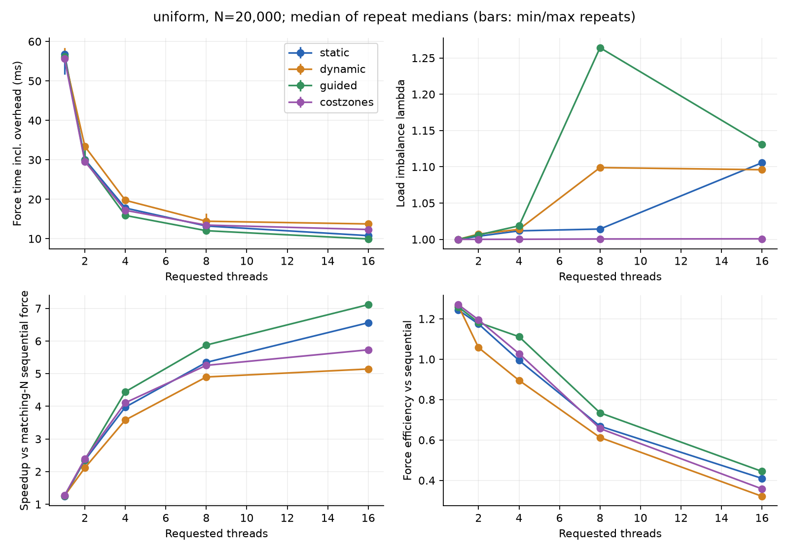
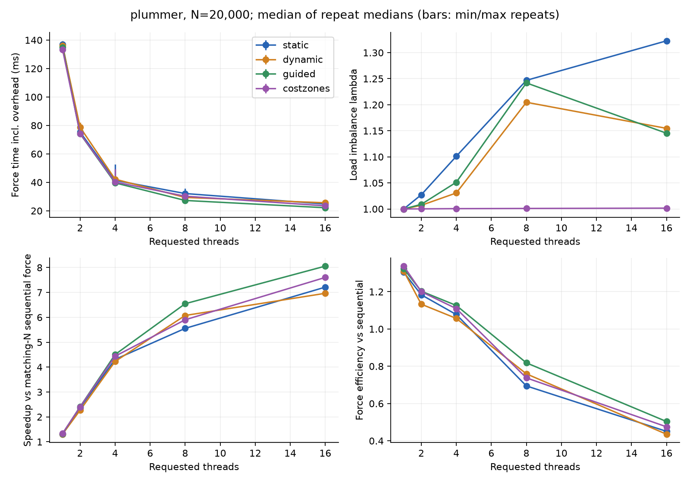
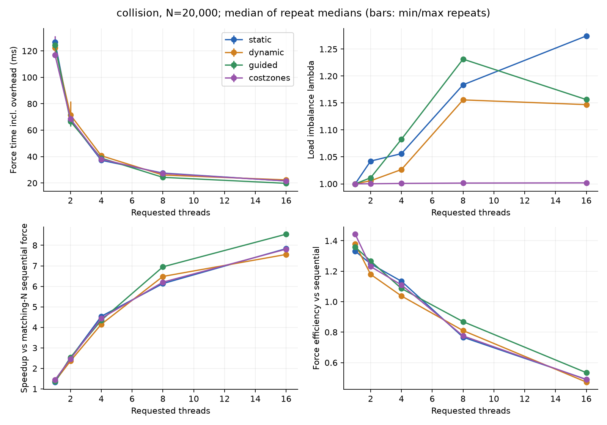
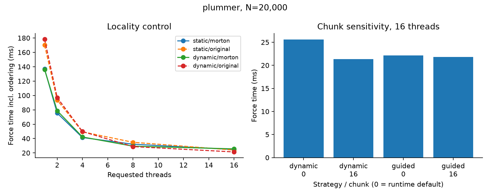
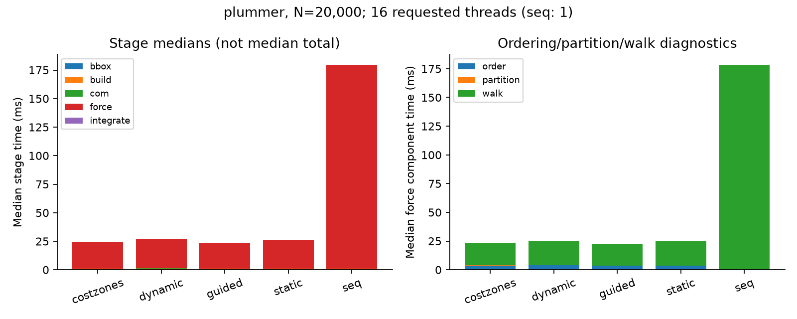
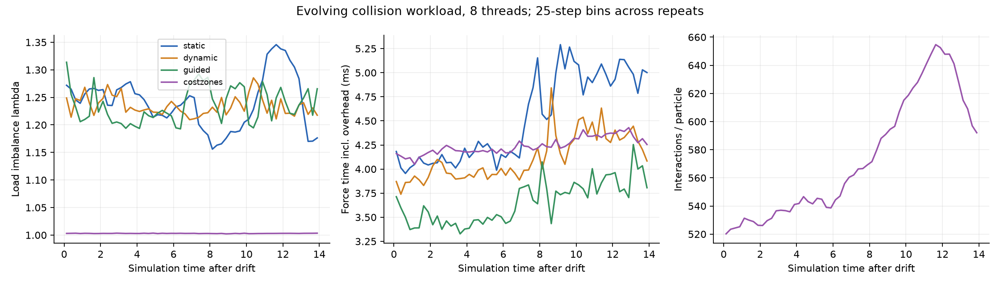
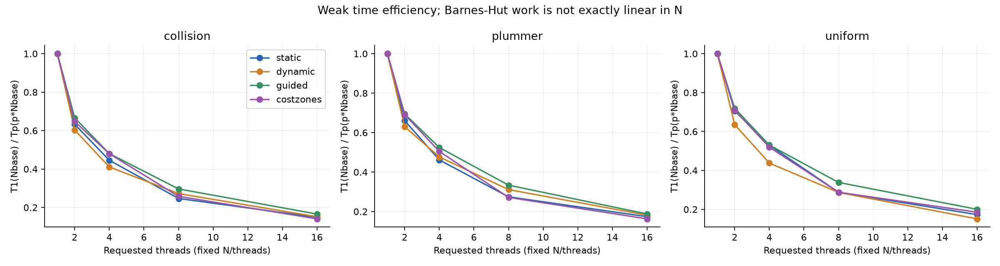

# Q2 local results: scheduling, locality, and costzones

The measured answer is that costzones keeps interaction counts almost perfectly balanced, but that does not make it the fastest scheduler on this machine. Guided scheduling has the lowest median force time among the four default Morton strategies at 16 workers for all three N=20,000 distributions. Ordering overhead, chunk size, and unequal core speeds matter alongside interaction-count balance.

## Reproduction and scope

- Run date: 2026-11-12, 14:07–14:13 Asia/Taipei.
- Hardware/OS: Intel Core i5-14400, 16 logical processors, Windows 11 (build 26300). This is a hybrid CPU; no thread-to-core mapping or per-core cycle data was collected.
- Compiler: WinLibs GCC 15.2.0, C++17, -O3 -Wall -Wextra -fopenmp; single precision.
- OpenMP: OMP_DYNAMIC=FALSE, OMP_PROC_BIND=FALSE, OMP_WAIT_POLICY=PASSIVE. Actual force team sizes matched every requested scaling point.
- Parameters: seed=42, theta=0.5, eps=0.01, dt=0.01. The local profile uses sequential tree construction and sequential COM in every parallel strategy.
- Strong scaling: N=20,000; weak scaling: N/p=2,000; p=1,2,4,8,16; three distributions. Each short run has 8 steps, with the first 2 excluded.
- Collision series: N=3,000, p=8, 1,400 steps (t=0 through 14), first 2 excluded.
- Three independent process repeats per configuration, randomized execution order. 609 successful runs, 25,752 raw step rows, 203 summarized configurations.

For each metric, first take the median over measured steps in a run and then the median over repeat medians. Error bars in the strong-scaling plots are min/max repeat medians, not statistical confidence intervals. force_s includes sorting, packing/scattering, partitioning, traversal, synchronization, and instrumentation. Speedups use a sequential run at the same N and distribution. Full definitions are in [the methods](../../q2.md).

Regenerate all tables and PNG/PDF figures from the archived raw data:

~~~bash
python3 -m pip install -r requirements-analysis.txt
python3 scripts/analyze_q2.py --input docs/results/q2-local --output docs/results/q2-local
~~~

The complete [manifest](manifest.json) records commands, configuration, compiler, environment, hardware, binary hash and completion. [Raw step data](steps.csv.gz), [summary table](summary.csv), [source snapshot](source.zip), and [audit/dependency versions](audit.json) are retained. The runtime's original per-run CSV/logs remain in results/q2-local-final in this checkout. A fresh run should use a new output directory.

## Strong scaling and load balance

N=20,000, p=16, default chunk, physically Morton-packed force data:

| Distribution | Strategy | Force ms | Lambda | Force speedup | Total speedup |
|---|---|---:|---:|---:|---:|
| uniform | static | 10.769 | 1.1056 | 6.56x | 6.07x |
| uniform | dynamic | 13.737 | 1.0960 | 5.14x | 4.85x |
| uniform | guided | 9.931 | 1.1309 | 7.12x | 6.53x |
| uniform | costzones | 12.328 | 1.0007 | 5.73x | 5.36x |
| plummer | static | 24.739 | 1.3227 | 7.21x | 6.89x |
| plummer | dynamic | 25.617 | 1.1547 | 6.97x | 6.66x |
| plummer | guided | 22.147 | 1.1454 | 8.06x | 7.67x |
| plummer | costzones | 23.469 | 1.0015 | 7.60x | 7.26x |
| collision | static | 21.527 | 1.2744 | 7.84x | 7.45x |
| collision | dynamic | 22.337 | 1.1470 | 7.55x | 7.19x |
| collision | guided | 19.753 | 1.1563 | 8.54x | 8.08x |
| collision | costzones | 21.598 | 1.0019 | 7.81x | 7.42x |

At 16 workers, Plummer costzones reduces lambda from 1.3227 (static/Morton) to 1.0015, and reduces force time from 24.739 to 23.469 ms (about 5.1%). Guided/Morton is still faster at 22.147 ms. For uniform input, costzones balances work slightly better but takes 12.328 ms versus static's 10.769 ms and guided's 9.931 ms. For the short collision run, static and costzones are close in total force time while guided is faster.

This supports the cost predictor's balance objective, while rejecting a blanket claim that the lowest interaction-count lambda always gives the lowest elapsed time. The hybrid CPU can execute equal interaction counts at unequal speeds; this is a plausible explanation for dynamic/guided workers completing more interactions on faster cores, but it was not isolated with core binding or cycle measurements.

Some one-worker sorted configurations outperform the original-order sequential baseline because the baseline includes neither spatial ordering nor packing. Therefore efficiency against that baseline can exceed 1 at low p; it is not a pure thread-scaling efficiency. The summary also supplies same-strategy/order/chunk one-worker speedup. At 16 workers, default guided matching-sequential force efficiency is about 44.5% (uniform), 50.4% (Plummer), and 53.4% (collision).

## Locality, ordering cost, and chunks

The control changes both target processing order and physical force-field packing. It also adds inverse-map lookups and sort/gather/scatter work; it cannot isolate cache locality alone. Original-order static work is close to interaction-balanced because the generators' original index order interleaves spatially different costs. Morton order clusters nearby costs, explaining why static's interaction-count balance can worsen.

At p=16, Plummer static/Morton traversal is 21.002 ms versus 23.938 ms in original order, but 3.743 ms of reordering makes full force time 24.739 versus 23.941 ms. Dynamic/Morton is 25.617 ms versus 21.359 ms in original order. At p=8, static/Morton improves Plummer full force time from 34.807 to 32.115 ms. The measured locality/overhead tradeoff therefore changes with the worker count and strategy.

At 16 workers, default Morton reordering costs roughly 3.2–4.0 ms per step; costzones adds about 0.38–0.39 ms of partition work. These are diagnostic medians; summing component medians need not equal the median force time.

| Distribution | dynamic chunk 1 ms | dynamic chunk 16 ms | guided chunk 1 ms | guided chunk 16 ms |
|---|---:|---:|---:|---:|
| uniform | 13.737 | 10.625 | 9.931 | 10.172 |
| plummer | 25.617 | 21.355 | 22.147 | 21.791 |
| collision | 22.337 | 20.093 | 19.753 | 20.349 |

Increasing dynamic's chunk from 1 to 16 helps all three distributions in this local sample, while guided's response is smaller and distribution-dependent. In Plummer, dynamic/Morton chunk 16 is 21.355 ms, close to dynamic/original chunk 1 at 21.359 ms. The formal profile tests more chunks rather than treating the default as the best configuration.

## Evolving collision workload

During the 1,400-step N=3,000 series, median interactions per particle rise from roughly 520 to around 650 near t=12 before declining. Across measured steps, costzones' median lambda is 1.0030 versus static's 1.2419. Previous-step costs therefore remain useful for balancing this evolving distribution.

Median full force times are 4.482 ms (static), 4.099 ms (dynamic), 3.619 ms (guided), and 4.224 ms (costzones). Costzones' ordering and partition diagnostics are approximately 1.522 and 0.168 ms. It remains well balanced while guided remains faster in this run. Binned medians can hide short spikes and the first-step fallback; the archived per-step rows retain both. No separation or density-centre trajectory was recorded, so the time of peak work is not claimed to be the exact physical point of closest approach.

## Fixed-particles-per-worker weak scaling

The table uses Nbase=2,000 and p=16 (N=32,000). Matching-N force speedup and weak time efficiency answer different questions:

| Distribution | Strategy | Matching-N force speedup | T1(Nbase)/Tp(16*Nbase) |
|---|---|---:|---:|
| uniform | guided | 8.46x | 0.200 |
| uniform | costzones | 7.83x | 0.185 |
| plummer | guided | 8.86x | 0.188 |
| plummer | costzones | 7.66x | 0.163 |
| collision | guided | 8.88x | 0.166 |
| collision | costzones | 7.51x | 0.141 |

Measured costzones interactions per particle (median measured row):

| Distribution | N=2,000 | N=32,000 |
|---|---:|---:|
| uniform | 246.0 | 491.3 |
| plummer | 530.8 | 1407.3 |
| collision | 429.6 | 1280.5 |

Fixed N/p does not hold Barnes-Hut interactions per worker constant. Greater depth/work per particle, hybrid-core behavior, and reordering/synchronization overhead all limit weak time efficiency here. These data do not establish asymptotic weak scalability.

## Validation and remaining integration

- [Single-precision physical suite](validation-float.txt): 141 passed, 0 failed.
- [Double-precision costzones physical suite](validation-double.txt): 18 passed, 0 failed.
- Parallel primitives, weighted partitions and multi-step particle equality pass in both precisions; all four force schedulers are compared on the same seq/lock tree.
- [Float CLI/CSV tests](validation-cli-float.txt) and [double CLI/CSV tests](validation-cli-double.txt): 4 integration test groups passed each, including actual team limits and scaling formulas.
- Raw-data audit: every row's per-thread work sums to total interactions; lambda matches the independent formula; timings are nonnegative and diagnostic intervals fit within force_s. All strategies/repeats share identical nodes/interactions for each matching physical input/step (1,544 distinct physical step keys).

The local evidence is reproducible and useful for Q2, but it is a small-N, unbound Windows study on a hybrid CPU. Three repeats provide descriptive variation, not a significance test. Rerun [the full profile](../../../experiments/q2-full.json) on the final machine, using its intended binding, larger N, and lock or future Morton builder. Formal group data aggregation, final report/slides, and validation of the future GPU implementation remain integration work after those implementations and hardware are available.

The Q2 implementation and local study are complete in the working checkout. GitHub issues remain open while source publication/review is pending.
